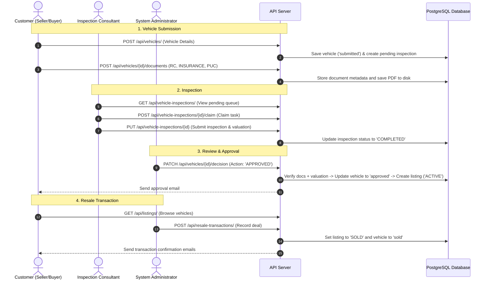
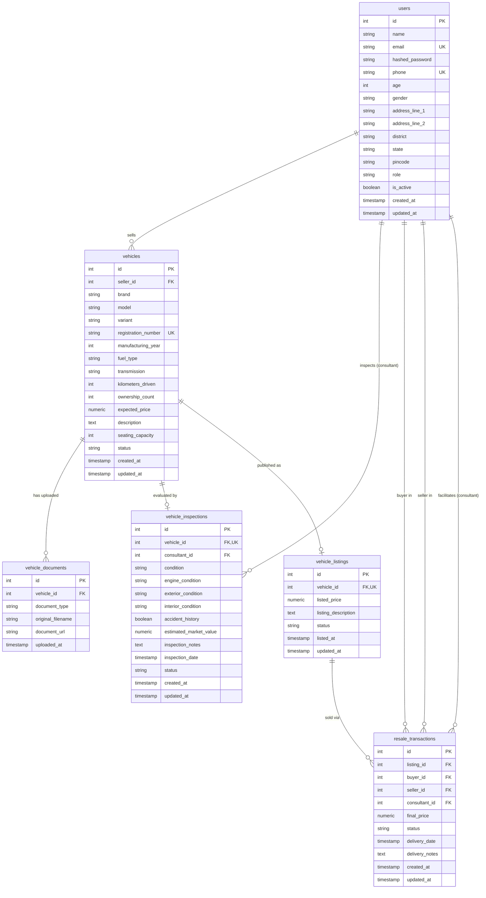

# Car Resale Consultancy API

A FastAPI and PostgreSQL backend service for managing used car resale operations, physical vehicle inspections, marketplace listings, and sales transactions. The system provides role-based access control (RBAC) across three user roles: Customers (buyers and sellers), Inspection Consultants, and Administrators.

---

## Table of Contents

- [Overview](#overview)
- [System Architecture](#system-architecture)
- [Business Workflow](#business-workflow)
- [Database Table Design](#database-table-design)
- [Tech Stack](#tech-stack)
- [Project Structure](#project-structure)
- [Authentication and Roles](#authentication-and-roles)
- [API Endpoints](#api-endpoints)
- [Environment Configuration](#environment-configuration)
- [Setup and Installation](#setup-and-installation)
- [Running Tests](#running-tests)
- [Code Formatting and Linting](#code-formatting-and-linting)

---

## Overview

The platform coordinates the vehicle resale process from submission to sale:

- **Customer Vehicle Submission**: Sellers register and submit vehicle specifications (brand, model, manufacturing year, expected price, etc.).
- **Document Verification**: Upload of mandatory PDF documents (Registration Certificate, Insurance, and PUC) with automatic size and extension validation.
- **Consultant Inspection**: Certified consultants claim unassigned vehicles from an inspection queue, conduct physical evaluations (engine, exterior, interior, condition, accident history), and submit market valuations.
- **Admin Review & Approval**: Admins verify that inspection is complete and mandatory documents exist before approving a vehicle. Approval automatically generates an active resale listing.
- **Marketplace Listings**: Publicly browsable listings with price, brand, and status filters.
- **Resale Transactions**: Admin-logged transactions that link buyers, sellers, and consultants, automatically transition listings and vehicles to sold status, and handle deal cancellation rollbacks.
- **Observability**: Request logging middleware that generates correlation IDs (`X-Correlation-ID`) and records execution duration with high-precision timers.
- **Email Notifications**: Asynchronous transaction and registration emails via Mailjet with retry logic, decoupled from database transactions.

---

## System Architecture

The project follows a layered Clean Architecture pattern with dependency inversion:

```
[ Incoming HTTP Request ]
           │
           ▼
[ Request Logging & Correlation ID Middleware ]
           │
           ▼
[ FastAPI Routes (OAuth2 Scopes & Validation) ]
           │
           ▼
[ Service Layer (Business Logic & Workflow Guards) ]
           │
           ▼
[ Repository Interfaces (Abstract Base Classes) ]
           │
           ▼
[ Repository Implementations (SQLAlchemy 2.0 Async) ]
           │
           ▼
[ PostgreSQL Database (via asyncpg) ]
```

### Design Principles:
1. **Layer Separation**: API routes handle HTTP input parsing and response serialization; services contain all business rules; repositories manage data queries.
2. **Dependency Inversion**: Services depend on abstract repository interfaces (`app/repositories/interfaces/`), not concrete database models.
3. **Atomic Transactions**: Multi-step operations run within `async with session.begin():` blocks so that failures revert all related changes.
4. **Side-Effect Isolation**: File operations and external email API calls execute outside database transactions to prevent transaction timeouts or inconsistent states.

---

## Business Workflow



---

## Database Table Design

### Entity-Relationship Diagram



### Table Definitions

#### 1. `users`
Stores registered user accounts across all roles (Customers, Consultants, and System Administrators).

| Column | Type | Nullable | Default / Constraints | Description |
| :--- | :--- | :--- | :--- | :--- |
| `id` | `INTEGER` | No | Primary Key, Auto-increment | Unique user identifier |
| `name` | `VARCHAR(100)` | No | | Full legal name |
| `email` | `VARCHAR` | No | Unique, Indexed | User login email address |
| `hashed_password` | `VARCHAR(255)` | No | | Argon2id hashed password string |
| `phone` | `VARCHAR` | No | Unique, Indexed | 10-digit mobile phone number |
| `age` | `INTEGER` | Yes | | Age in years (18-100) |
| `gender` | `VARCHAR(20)` | Yes | | Gender (`MALE`, `FEMALE`, `OTHER`) |
| `address_line_1` | `VARCHAR(255)` | Yes | | Primary street address |
| `address_line_2` | `VARCHAR(255)` | Yes | | Apartment, suite, or landmark |
| `district` | `VARCHAR(100)` | Yes | | District or city name |
| `state` | `VARCHAR(100)` | Yes | | State or province |
| `pincode` | `VARCHAR(10)` | Yes | | 6-digit postal code |
| `role` | `VARCHAR(20)` | No | `'CUSTOMER'` | Role: `'CUSTOMER'`, `'CONSULTANT'`, `'ADMIN'` |
| `is_active` | `BOOLEAN` | No | `TRUE` | Soft-delete active flag |
| `created_at` | `TIMESTAMP` | No | `func.now()` | Record creation timestamp |
| `updated_at` | `TIMESTAMP` | No | `func.now()`, on update | Record update timestamp |

**Check Constraints**:
- `user_role_check`: `role IN ('CUSTOMER', 'CONSULTANT', 'ADMIN')`
- `user_gender_check`: `gender IN ('MALE', 'FEMALE', 'OTHER')`

---

#### 2. `vehicles`
Stores submitted vehicle specifications and lifecycle statuses.

| Column | Type | Nullable | Default / Constraints | Description |
| :--- | :--- | :--- | :--- | :--- |
| `id` | `INTEGER` | No | Primary Key, Auto-increment | Unique vehicle identifier |
| `seller_id` | `INTEGER` | No | FK $\rightarrow$ `users.id` (RESTRICT), Indexed | User who submitted the vehicle |
| `brand` | `VARCHAR(50)` | No | | Manufacturer brand (e.g., Toyota, Honda) |
| `model` | `VARCHAR(50)` | No | | Model name (e.g., Camry, Civic) |
| `variant` | `VARCHAR(50)` | Yes | | Vehicle trim/variant (e.g., Hybrid LE) |
| `registration_number` | `VARCHAR(20)` | No | Unique, Indexed | Standardized license plate number |
| `manufacturing_year` | `INTEGER` | No | | Year of manufacture |
| `fuel_type` | `VARCHAR(30)` | No | | Engine fuel: `PETROL`, `DIESEL`, `ELECTRIC`, etc. |
| `transmission` | `VARCHAR(30)` | No | | Transmission: `MANUAL`, `AUTOMATIC` |
| `kilometers_driven` | `INTEGER` | No | | Odometer distance in km |
| `ownership_count` | `INTEGER` | No | `1` | Number of previous registered owners |
| `expected_price` | `NUMERIC(12, 2)`| No | | Seller's expected selling price |
| `description` | `TEXT` | Yes | | Maintenance and condition remarks |
| `seating_capacity` | `INTEGER` | No | | Total seat count (1-20) |
| `status` | `VARCHAR(20)` | No | `'submitted'` | Lifecycle status |
| `created_at` | `TIMESTAMP` | No | `func.now()` | Record creation timestamp |
| `updated_at` | `TIMESTAMP` | No | `func.now()`, on update | Record update timestamp |

**Check Constraints**:
- `vehicle_status_check`: `status IN ('submitted', 'approved', 'rejected', 'sold', 'deactivated')`
- `vehicle_expected_price_check`: `expected_price > 0`
- `vehicle_km_check`: `kilometers_driven >= 0`
- `vehicle_manufacturing_year_check`: `manufacturing_year >= 1900`

---

#### 3. `vehicle_documents`
Stores metadata and file paths for uploaded vehicle verification PDFs.

| Column | Type | Nullable | Default / Constraints | Description |
| :--- | :--- | :--- | :--- | :--- |
| `id` | `INTEGER` | No | Primary Key, Auto-increment | Unique document record ID |
| `vehicle_id` | `INTEGER` | No | FK $\rightarrow$ `vehicles.id` (CASCADE), Indexed | Vehicle the document belongs to |
| `document_type` | `VARCHAR(30)` | No | | Document type: `RC`, `INSURANCE`, `PUC` |
| `original_filename` | `VARCHAR(255)`| No | | User-uploaded file name |
| `document_url` | `VARCHAR(500)`| No | | Relative filesystem storage path |
| `uploaded_at` | `TIMESTAMP` | No | `func.now()` | Upload timestamp |

**Constraints**:
- `uq_vehicle_document_type`: `UNIQUE (vehicle_id, document_type)` (ensures at most one document per type per vehicle)
- `vehicle_document_type_check`: `document_type IN ('RC', 'INSURANCE', 'PUC')`

---

#### 4. `vehicle_inspections`
Tracks consultant assignments, condition evaluations, and market valuations for submitted vehicles.

| Column | Type | Nullable | Default / Constraints | Description |
| :--- | :--- | :--- | :--- | :--- |
| `id` | `INTEGER` | No | Primary Key, Auto-increment | Unique inspection record ID |
| `vehicle_id` | `INTEGER` | No | FK $\rightarrow$ `vehicles.id` (RESTRICT), Unique, Indexed | Vehicle being inspected (1-to-1) |
| `consultant_id` | `INTEGER` | Yes | FK $\rightarrow$ `users.id` (SET NULL), Indexed | Assigned consultant user ID |
| `condition` | `VARCHAR(20)` | Yes | | Overall physical condition rating |
| `engine_condition` | `VARCHAR(20)` | Yes | | Engine inspection rating |
| `exterior_condition` | `VARCHAR(20)`| Yes | | Exterior bodywork rating |
| `interior_condition` | `VARCHAR(20)`| Yes | | Cabin interior rating |
| `accident_history` | `BOOLEAN` | Yes | | Accident damage reported |
| `estimated_market_value`| `NUMERIC(12, 2)`| Yes | | Consultant market valuation |
| `inspection_notes` | `TEXT` | Yes | | Detailed inspection remarks |
| `inspection_date` | `TIMESTAMP` | Yes | | Date physical inspection was completed |
| `status` | `VARCHAR(20)` | No | `'PENDING'` | Status: `'PENDING'`, `'COMPLETED'`, `'CANCELLED'` |
| `created_at` | `TIMESTAMP` | No | `func.now()` | Record creation timestamp |
| `updated_at` | `TIMESTAMP` | No | `func.now()`, on update | Record update timestamp |

**Check Constraints**:
- `vehicle_inspection_condition_check`: `condition IN ('excellent', 'good', 'fair', 'poor')`
- `vehicle_inspection_engine_condition_check`: `engine_condition IN ('excellent', 'good', 'fair', 'poor')`
- `vehicle_inspection_exterior_condition_check`: `exterior_condition IN ('excellent', 'good', 'fair', 'poor')`
- `vehicle_inspection_interior_condition_check`: `interior_condition IN ('excellent', 'good', 'fair', 'poor')`
- `vehicle_inspection_status_check`: `status IN ('PENDING', 'COMPLETED', 'CANCELLED')`

---

#### 5. `vehicle_listings`
Stores published vehicle listings visible to marketplace buyers.

| Column | Type | Nullable | Default / Constraints | Description |
| :--- | :--- | :--- | :--- | :--- |
| `id` | `INTEGER` | No | Primary Key, Auto-increment | Unique listing identifier |
| `vehicle_id` | `INTEGER` | No | FK $\rightarrow$ `vehicles.id` (RESTRICT), Unique, Indexed | Approved vehicle for sale (1-to-1) |
| `listed_price` | `NUMERIC(12, 2)`| No | | Published asking price |
| `listing_description`| `TEXT` | Yes | | Marketing description |
| `status` | `VARCHAR(20)` | No | `'ACTIVE'` | Status: `'ACTIVE'`, `'INACTIVE'`, `'SOLD'` |
| `listed_at` | `TIMESTAMP` | No | `func.now()` | Publication timestamp |
| `updated_at` | `TIMESTAMP` | No | `func.now()`, on update | Record update timestamp |

**Check Constraints**:
- `vehicle_listing_status_check`: `status IN ('ACTIVE', 'INACTIVE', 'SOLD')`
- `vehicle_listing_price_positive`: `listed_price > 0`

---

#### 6. `resale_transactions`
Audited financial and handover ledger recording vehicle sales between buyers and sellers.

| Column | Type | Nullable | Default / Constraints | Description |
| :--- | :--- | :--- | :--- | :--- |
| `id` | `INTEGER` | No | Primary Key, Auto-increment | Unique transaction identifier |
| `listing_id` | `INTEGER` | No | FK $\rightarrow$ `vehicle_listings.id` (RESTRICT), Indexed | Listing associated with sale |
| `buyer_id` | `INTEGER` | No | FK $\rightarrow$ `users.id` (RESTRICT), Indexed | Customer buyer ID |
| `seller_id` | `INTEGER` | No | FK $\rightarrow$ `users.id` (RESTRICT), Indexed | Customer seller ID |
| `consultant_id` | `INTEGER` | Yes | FK $\rightarrow$ `users.id` (SET NULL), Indexed | Facilitating consultant (optional) |
| `final_price` | `NUMERIC(12, 2)`| No | | Final agreed selling price |
| `status` | `VARCHAR(20)` | No | `'CONFIRMED'` | Status: `'CONFIRMED'`, `'DELIVERED'`, `'CANCELLED'` |
| `delivery_date` | `TIMESTAMP` | Yes | | Vehicle delivery timestamp |
| `delivery_notes` | `TEXT` | Yes | | Handover and title transfer notes |
| `created_at` | `TIMESTAMP` | No | `func.now()` | Record creation timestamp |
| `updated_at` | `TIMESTAMP` | No | `func.now()`, on update | Record update timestamp |

**Check Constraints**:
- `final_price_check`: `final_price > 0`
- `resale_transaction_status_check`: `status IN ('CONFIRMED', 'DELIVERED', 'CANCELLED')`
- `resale_buyer_not_seller_check`: `buyer_id != seller_id`

---

## Tech Stack

| Component | Tool / Library | Purpose |
| :--- | :--- | :--- |
| Framework | FastAPI | Web framework and OpenAPI generation |
| Language | Python 3.12+ | Core runtime |
| Database | PostgreSQL | Relational data storage |
| Async Driver | asyncpg / psycopg 3 | Async database connectivity |
| ORM | SQLAlchemy 2.0 | Asynchronous object-relational mapping |
| Validation | Pydantic v2 | Request/response data validation |
| Authentication | PyJWT | JSON Web Token encoding and decoding |
| Password Hashing | pwdlib (Argon2id) | Secure credential hashing |
| File Handling | aiofiles | Non-blocking file I/O for PDF storage |
| HTTP Client | HTTPX | Async client for Mailjet email delivery |
| Linter / Formatter | Ruff | Linting and code style enforcement |
| Testing | pytest, pytest-asyncio | Integration and unit testing |

---

## Project Structure

```
LEVEL-2-FINAL-PROJECT/
├── app/
│   ├── api/
│   │   ├── dependencies/
│   │   │   └── dependencies.py        # Dependency injection providers
│   │   └── routes/
│   │       ├── auth.py                # Login, registration, token refresh
│   │       ├── user.py                # User profiles and user management
│   │       ├── vehicle.py             # Vehicle submissions, documents, decisions
│   │       ├── vehicle_inspection.py  # Inspection claims, reports, cancellations
│   │       ├── vehicle_listing.py     # Marketplace listings
│   │       └── resale_transaction.py  # Sales transactions and ledger
│   ├── core/
│   │   ├── config.py                  # Environment settings via Pydantic
│   │   ├── constants.py               # Enums and constants
│   │   ├── scopes.py                  # Role scope mappings
│   │   └── security.py                # JWT and password utilities
│   ├── database/
│   │   └── database.py                # Database connection and async session factory
│   ├── exceptions/
│   │   ├── custom_exceptions.py       # Custom application exceptions
│   │   └── email_exception.py         # Email delivery exceptions
│   ├── middleware/
│   │   └── http_middleware.py         # Correlation ID and latency middleware
│   ├── models/                        # SQLAlchemy ORM models
│   │   ├── base.py
│   │   ├── user.py
│   │   ├── vehicle.py
│   │   ├── vehicle_document.py
│   │   ├── vehicle_inspection.py
│   │   ├── vehicle_listing.py
│   │   └── resale_transaction.py
│   ├── repositories/
│   │   ├── interfaces/                # Abstract repository contracts
│   │   └── implementations/           # SQLAlchemy concrete queries
│   ├── schemas/                       # Pydantic validation schemas
│   ├── scripts/
│   │   └── create_admin.py            # Startup admin seeder
│   ├── services/                      # Business logic layer
│   └── utilities/
│       ├── file_handler.py            # PDF validation and disk operations
│       └── log.py                     # Logging configuration
├── tests/
│   ├── conftest.py                    # Pytest fixtures and database truncation
│   ├── api-test/                      # Integration tests for all endpoints (59 tests)
│   └── unit-test/                     # Service unit tests with mocks (35 tests)
├── uploads/                           # Local storage for uploaded PDF documents
├── .env.example                       # Example environment variables
├── pyproject.toml                     # Ruff and pytest configuration
└── requirements.txt                   # Project dependencies
```

---

## Authentication and Roles

Authentication uses OAuth2 Bearer tokens with JWT. Permissions are verified per endpoint using security scopes.

### Role Scope Mappings

- **CUSTOMER**:
  - `vehicle:create`, `vehicle:read_own`, `vehicle:update_own`, `vehicle:delete_own`
  - `inspection:read_own`
  - `listing:read`
  - `transaction:read`
  - `user:read_own`, `user:update_own`
- **CONSULTANT**:
  - `vehicle:read`, `vehicle:read_own`
  - `inspection:read`, `inspection:read_own`, `inspection:update`, `inspection:claim`
  - `listing:read`
  - `transaction:read`
  - `user:read_own`, `user:update_own`
- **ADMIN**:
  - Contains all customer and consultant scopes, plus:
  - `user:read`, `user:create`, `user:delete`, `user:update`
  - `vehicle:update`, `vehicle:delete`
  - `listing:update`
  - `transaction:create`, `transaction:update`

### Security Rules:
- Deactivated accounts are rejected at login, on token refresh, and during token verification in `get_current_user`.
- Users cannot modify their own `role` or `is_active` status via profile updates.
- Email addresses are immutable after registration.

---

## API Endpoints

### Authentication (`/api/auth`)

| Method | Endpoint | Access | Summary |
| :--- | :--- | :--- | :--- |
| `POST` | `/api/auth/register/user` | Public | Register customer account |
| `POST` | `/api/auth/register/consultant` | Admin | Register consultant account |
| `POST` | `/api/auth/login` | Public | OAuth2 password login, returns access + refresh tokens |
| `POST` | `/api/auth/refresh` | Public | Generate new access token from refresh token |

### Users (`/api/users`)

| Method | Endpoint | Access | Summary |
| :--- | :--- | :--- | :--- |
| `GET` | `/api/users/` | Admin | List users with pagination and filters (`search`, `role`, `district`, `sort_by`, etc.) |
| `GET` | `/api/users/me` | Authenticated | View current authenticated user's profile |
| `PATCH` | `/api/users/me` | Authenticated | Update current authenticated user's profile |
| `GET` | `/api/users/{user_id}` | Own User / Admin | Get user profile by ID |
| `PATCH` | `/api/users/{user_id}` | Own User / Admin | Update user profile by ID |
| `DELETE` | `/api/users/{user_id}` | Admin | Soft delete user (deactivates their active listings) |

### Vehicles (`/api/vehicles`)

| Method | Endpoint | Access | Summary |
| :--- | :--- | :--- | :--- |
| `POST` | `/api/vehicles/` | Customer / Admin | Submit vehicle details for resale |
| `GET` | `/api/vehicles/` | Authenticated | List vehicles (Customers view own; Staff view all) |
| `GET` | `/api/vehicles/{id}` | Own User / Staff | Get vehicle details by ID |
| `PATCH` | `/api/vehicles/{id}` | Own Seller / Admin | Update vehicle (only while status is `submitted`) |
| `POST` | `/api/vehicles/{id}/documents` | Own Seller / Admin | Upload or replace vehicle document (`RC`, `INSURANCE`, `PUC`) |
| `GET` | `/api/vehicles/{id}/documents` | Own Seller / Staff | List uploaded documents for a vehicle |
| `DELETE` | `/api/vehicles/{id}/documents/{type}` | Own Seller / Admin | Delete vehicle document (only while `submitted`) |
| `PATCH` | `/api/vehicles/{id}/decision` | Admin | Lifecycle decision: `APPROVED`, `REJECTED`, or `RESUBMIT` |
| `DELETE` | `/api/vehicles/{id}` | Own Seller / Admin | Soft delete vehicle (sets status to `deactivated`) |

### Vehicle Inspections (`/api/vehicle-inspections`)

| Method | Endpoint | Access | Summary |
| :--- | :--- | :--- | :--- |
| `GET` | `/api/vehicle-inspections/` | Consultant / Admin | Browse inspection queue with filters |
| `GET` | `/api/vehicle-inspections/my-inspections` | Customer | View inspections for own submitted vehicles |
| `GET` | `/api/vehicle-inspections/{id}` | Assigned / Admin / Seller | Full inspection details including documents |
| `POST` | `/api/vehicle-inspections/{id}/claim` | Consultant | Claim an unassigned pending inspection |
| `POST` | `/api/vehicle-inspections/{id}/unclaim` | Assigned / Admin | Release inspection back to pending pool |
| `PUT` | `/api/vehicle-inspections/{id}` | Assigned / Admin | Submit or update inspection report and valuation |
| `PATCH` | `/api/vehicle-inspections/{id}/cancel` | Admin | Cancel inspection and mark vehicle rejected |

### Vehicle Listings (`/api/listings`)

| Method | Endpoint | Access | Summary |
| :--- | :--- | :--- | :--- |
| `GET` | `/api/listings/` | Authenticated | Browse listings with price, brand, and status filters |
| `GET` | `/api/listings/{id}` | Authenticated | Get detailed listing by ID |
| `PATCH` | `/api/listings/{id}` | Admin | Update listing status (`ACTIVE`/`INACTIVE`), price, or notes |

### Resale Transactions (`/api/resale-transactions`)

| Method | Endpoint | Access | Summary |
| :--- | :--- | :--- | :--- |
| `POST` | `/api/resale-transactions/` | Admin | Record resale transaction (marks listing and vehicle as sold) |
| `GET` | `/api/resale-transactions/` | Authenticated | View transactions (Customers view own; Admins view all) |
| `PATCH` | `/api/resale-transactions/{id}` | Admin | Update delivery notes or cancel transaction (restores listing) |

### Health Checks

| Method | Endpoint | Access | Summary |
| :--- | :--- | :--- | :--- |
| `GET` | `/api/health` | Public | Service health status |
| `GET` | `/` | Public | API name and version |

---

## Environment Configuration

Create a `.env` file in the root directory:

```ini
API_NAME="Car Resale Consultancy API"
API_VERSION="1.0.0"

DATABASE_HOST=localhost
DATABASE_PORT=5432
DATABASE_NAME=car_resale_consultancy
DATABASE_USER=postgres
DATABASE_PASSWORD=your_password
DATABASE_DRIVERNAME=postgresql+asyncpg

JWT_SECRET_KEY=your_jwt_secret_key
JWT_ALGORITHM=HS256
JWT_ACCESS_EXPIRATION_MINUTE=30
JWT_REFRESH_EXPIRATION_DAYS=7

MAILJET_API_KEY=your_mailjet_api_key
MAILJET_SECRET_KEY=your_mailjet_secret_key

MAX_RETRIES=4
BASE_DELAY=1
MAX_DELAY=12
```

---

## Setup and Installation

### 1. Prerequisites
- Python 3.12 or higher
- PostgreSQL 14 or higher

### 2. Environment Setup

```bash
# Clone the repository
git clone <repo-url>
cd LEVEL-2-FINAL-PROJECT

# Create and activate virtual environment
python -m venv .venv

# On Windows (PowerShell):
.\.venv\Scripts\Activate.ps1
# On Linux / macOS:
source .venv/bin/activate

# Install dependencies
pip install -r requirements.txt
```

### 3. Database Creation

```sql
CREATE DATABASE car_resale_consultancy;
CREATE DATABASE car_resale_consultancy_test;
```

### 4. Run the Server

```bash
uvicorn app.main:app --reload --host 127.0.0.1 --port 8000
```

On startup, the application creates a default admin account if one does not exist:
- **Email**: `admin@example.com`
- **Password**: `AdminPassword@123`

### 5. Interactive Documentation
- **Swagger UI**: http://127.0.0.1:8000/docs
- **ReDoc**: http://127.0.0.1:8000/redoc

---

## Running Tests

Tests run against the isolated `car_resale_consultancy_test` database. Database tables are truncated automatically between test cases.

```bash
# Run all tests (94 tests)
pytest -v

# Run only API integration tests
pytest tests/api-test/ -v

# Run only service unit tests
pytest tests/unit-test/ -v
```

---

## Code Formatting and Linting

The project uses Ruff for linting and formatting, configured in `pyproject.toml`.

```bash
# Check for lint issues
ruff check .

# Apply safe lint fixes
ruff check --fix .

# Verify formatting
ruff format --check .

# Format code
ruff format .
```
